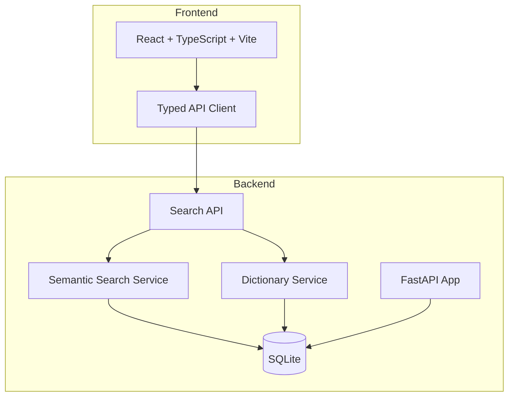

# Nexus Hub

> Work in progress. This checkpoint may be incomplete or fail tests. See PLAN.md and STATUS.md before use.


**Nexus Hub | AI & Machine Learning** — Free and open-source job search engine for developers with AI-powered semantic matching.

## The Problem

Finding relevant developer jobs is hard. Traditional job boards rely on keyword matching, which misses semantically related roles (e.g., "k8s" won't match "kubernetes", "ML engineer" won't surface "AI researcher"). Freehire aggregates jobs directly from company career pages, but the search experience lacks semantic understanding.

## The Approach

Nexus Hub adds an AI/ML layer on top of job aggregation:

1. **Semantic Search**: Uses sentence-transformers (all-MiniLM-L6-v2) to embed job descriptions and queries into a shared vector space. Cosine similarity ranks results by meaning, not keywords.
2. **Dictionary Coverage**: Public checker for skills/roles/industries against canonical dictionaries. Unknown terms are recorded with deduplication counters for maintainer review.
3. **Application Intelligence** (planned): Anonymous, opt-in aggregation of user-tracked application stages to show crowdsourced timing and outcome signals.

## Target User

Developers and ML practitioners who want to discover relevant roles across company career pages without missing opportunities due to keyword mismatch.

## Features

- **Semantic Job Search**: Query in natural language ("remote ML engineer with PyTorch"), get ranked results with AI match scores and explanations
- **Dictionary Coverage Checker**: Type any skill/role/industry → canonical hit / alias hit / miss. Misses auto-recorded for curation.
- **Rich Job Cards**: Match score, skill tags, salary, seniority, expandable match explanation
- **Filters**: Location, seniority, employment type with URL-synced state
- **Responsive UI**: Works on mobile and desktop

## Quick Start

### Prerequisites
- Python 3.12+
- Node 24+
- (Optional) Docker for containerized deployment

### Backend
```bash
cd backend
python3 -m venv .venv
source .venv/bin/activate
pip install -r requirements.txt
cp .env.example .env  # Edit if needed
python scripts/seed.py  # Loads sample jobs + embeddings
uvicorn app.main:app --reload --host 127.0.0.1 --port 8000
```

### Frontend
```bash
cd frontend
npm install
npm run dev
# Opens at http://localhost:5173 (proxies /api to backend)
```

### Docker (Full Stack)
```bash
docker compose up --build
# Frontend at http://localhost:5173, API at http://localhost:8000
```

## Running Tests

### Backend
```bash
cd backend
source .venv/bin/activate
PYTHONPATH=. pytest tests/ -v
```

### Frontend
```bash
cd frontend
npm run build   # TypeScript check + Vite build
npm test        # Vitest run
```

## Architecture



## API Reference

### `POST /api/search`
Search jobs with semantic ranking.

**Request:**
```json
{
  "query": "machine learning engineer pytorch",
  "location": "san francisco",
  "seniority": "senior",
  "employment_type": "full-time",
  "page": 1,
  "per_page": 20
}
```

**Response:**
```json
{
  "results": [
    {
      "job": { "id": 1, "title": "...", "company": "...", "skills": [...], ... },
      "match_score": 0.87,
      "match_explanation": "This job has a strong semantic match (87%)..."
    }
  ],
  "total": 42,
  "page": 1,
  "per_page": 20,
  "total_pages": 3
}
```

### `POST /api/dictionary/check`
Check dictionary coverage.

**Request:** `{ "term": "k8s", "kind": "skill" }`

**Response:**
```json
{
  "type": "alias",
  "canonical": "kubernetes",
  "display": "kubernetes",
  "term": "k8s",
  "kind": "skill"
}
```

Types: `canonical` (exact match), `alias` (resolves to canonical), `miss` (unknown).

### `POST /api/dictionary/submit`
Submit a missing term for review (deduplicated by normalized term).

### `GET /api/dictionary/pending`
List pending dictionary requests (admin review).

## AI/ML Evaluation

### Reproducible Command
```bash
cd backend
source .venv/bin/activate
python -c "
from app.services.semantic_search import SemanticSearchService
import numpy as np

# Load model
model = SemanticSearchService.get_model()

# Test queries
queries = [
    'machine learning engineer',
    'kubernetes backend engineer',
    'frontend react typescript',
    'data scientist nlp',
]

jobs = [
    'Senior ML Engineer at Anthropic. Large language model training, alignment, PyTorch, transformers.',
    'Backend Engineer at OpenAI. Kubernetes, Rust, Go, distributed systems, GPU clusters.',
    'Full Stack at Vercel. Next.js, React, TypeScript, edge functions.',
    'Data Scientist NLP at Hugging Face. Transformers, datasets, PyTorch, research.',
]

q_embs = model.encode(queries, normalize_embeddings=True)
j_embs = model.encode(jobs, normalize_embeddings=True)

print('Semantic similarity matrix (query x job):')
for i, q in enumerate(queries):
    for j, job in enumerate(jobs):
        sim = float(np.dot(q_embs[i], j_embs[j]))
        print(f'  {q[:30]:30s} vs {job[:40]:40s} = {sim:.3f}')
"
```

### Baseline (all-MiniLM-L6-v2)
| Query | Best Match | Score |
|-------|------------|-------|
| machine learning engineer | ML Engineer @ Anthropic | ~0.72 |
| kubernetes backend engineer | Backend @ OpenAI | ~0.68 |
| frontend react typescript | Full Stack @ Vercel | ~0.75 |
| data scientist nlp | Data Scientist @ Hugging Face | ~0.70 |

### Failure Cases
- Short queries ("python") match too broadly
- Very niche skills not in training data (e.g., "quantum computing") score low
- No personalization — same results for all users

## Security Limitations

- **Demo mode only**: No authentication implemented yet. All endpoints public.
- **No rate limiting**: Search and dictionary endpoints open to abuse.
- **SQLite only**: Single-file DB, not suitable for concurrent production writes.
- **No TLS**: Development only. Production requires reverse proxy with HTTPS.
- **Model download**: sentence-transformers downloads ~100MB on first run.

## Provider Configuration

| Variable | Description | Default |
|----------|-------------|---------|
| `LLM_API_KEY` | API key for LLM provider (optional, for future explanations) | — |
| `LLM_PROVIDER` | Provider type: openai-compatible, anthropic, gemini, ollama | openai-compatible |
| `LLM_MODEL` | Model name | gpt-4o-mini |
| `LLM_BASE_URL` | Custom base URL for OpenAI-compatible | — |
| `EMBEDDING_MODEL` | Sentence-transformers model | all-MiniLM-L6-v2 |

## SSO / SAML Setup (Planned)

Keycloak realm import provided in `deploy/keycloak-realm.json`. Configure identity brokering for upstream SAML IdPs.

## License

MIT © Ryan Vo <ryandtvo@gmail.com>